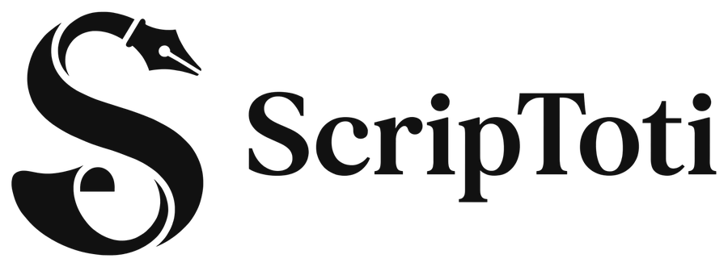

<p align="center">
  <picture>
    <source media="(prefers-color-scheme: dark)" srcset="docs/logo-esteso-bianco.png">
    
  </picture>
</p>

# ScripToti

**[English](#scriptoti) · [Italiano](#scriptoti-in-italiano)**

> **A note from the author.** I am not a programmer. I built ScripToti entirely by talking with two AI assistants, Claude (Anthropic) and Codex (OpenAI), to have the screenwriting tool I wanted for my own work. I use it for my work, and I share it in case it is useful to someone else too.

**ScripToti is a free program for writing screenplays** (films, shorts, series). It runs in your browser: nothing to install, no account to create.

👉 **To use it, just open https://scriptoti.salvatorefrisina.com**

The program speaks English or Italian, following your browser's language. You can switch it any time in **View → Lingua / Language**.

You write your script as plain text and ScripToti lays it out in the standard film format by itself: Courier font, the right margins, centered character names, page numbers. When you are done, you export a PDF that is ready to send or print.

---

## Why ScripToti exists

I needed a screenwriting program that let me work on **the same file on a Mac and on Windows**, at different times of the day, and always find it up to date, without exporting, importing or emailing copies to myself. The programs I knew either run on one system only, keep scripts in their own cloud behind a subscription, or use closed formats.

This is what we built to get there:

- **One app, every computer.** ScripToti runs in the browser and is the same on Mac, Windows and Linux. You can install it as an app, and it keeps working without internet after the first visit.
- **Your script is a normal file.** Each document is a plain `.fountain` file on your disk, not data locked inside the program. Fountain is open text: the same file opens in Highland, Beat, Slugline or any text editor.
- **It writes straight to that file.** With Chrome or Edge, ScripToti opens and saves the file itself, with automatic saving. Keep it in a synced folder (Google Drive, Dropbox, OneDrive) and the sync service carries it to your other computers: in the evening you reopen it on the other machine and it is the latest version.
- **It never overwrites blindly.** Before writing, ScripToti checks that the file was not changed elsewhere in the meantime: by another computer, another program or another window. If it was, it stops with **File conflict** instead of overwriting, shows you the two versions side by side and lets you choose. The version you set aside stays in Recovery.
- **The production work travels with the script.** Comments, coloured revisions and locked page and scene numbers (12A, 4B…) are saved inside the `.fountain` file itself, in a hidden block that other programs ignore. You find everything on the other computer too.
- **Several people, at the same time.** Share a script with a link and the changes reach the others in about a second, while the file in the shared folder remains the common copy.
- **On the phone too.** On a phone the text fits the screen, with keys made for screenplays and voice dictation, to reread and draft away from the computer.

## What a screenplay is, and why it needs a dedicated program

A screenplay is not written like a story: it follows precise layout rules, the same all over the world. Each scene starts with a heading that says where and when, followed by a description of what we see. When someone speaks, their name goes in the middle in capitals, with the line underneath. Doing this by hand in an ordinary word processor is slow and awkward: ScripToti does it for you as you type.

## An example

You type this:

```
INT. KITCHEN - NIGHT

Marta opens the fridge. It is empty.

MARTA
Who finished the milk?

LUCA (V.O.)
Not me.
```

and ScripToti turns it into a real screenplay page, with every part in its place. No menus or buttons needed: it understands by itself that `INT. KITCHEN - NIGHT` starts a scene, that `MARTA` is a character and that the line below is what she says.

The format is called **Fountain**: a simple, open way to write screenplays as text, also used by other programs (Highland, Beat, Slugline). Your scripts stay ordinary `.fountain` files that you can open anywhere, even in a plain text editor.

## What it can do

- **Automatic layout** to the film standard, with the page count.
- **Help as you type**: it suggests the characters and places you already used, capitalises the start of sentences, recognises transitions such as `cut to:` and shots such as `ANGLE ON` and puts them in the right place.
- **PDF export**, also of selected pages only.
- **Works on your own files**: you open and save files on your computer, with automatic saving and recovery if something goes wrong.
- **Works without internet** once you have opened it the first time.
- **Installs as an app** (with Chrome or Edge, from the install icon in the address bar) and opens like a normal program.
- **Write together**: share a script with a link and work on it with other people at the same time, seeing each other's changes live.
- **Production tools**: coloured revisions, locked page and scene numbers (1A, 2B…), an actor's copy with their lines highlighted.
- **Comments, find and replace, renaming a character** throughout the script.
- **Syntax check**: it warns you when something will not be read the way you meant, for example a scene heading that is not recognised.
- **A complete manual** inside the program, in the **Help** menu, in English and Italian.

## Limits and known issues (version 0.37.0)

ScripToti is young and changes often. This list is updated with each version.

**Limits of browsers and devices**

- Working straight on the file on your disk needs **Chrome or Edge** on a computer. Safari and Firefox do not allow it: there ScripToti works on a copy, which you save or download again.
- On **iPhone and iPad** ScripToti works on a copy of the file you choose, also from Drive. To put it back on Drive use **Send file**. You cannot open a file with ScripToti straight from the Google Drive app. A real app for iPhone and Android, planned, will remove these limits.
- On a computer, **renaming a file saved on disk is refused** for safety: the browser does not let ScripToti check that the new name is free in that folder. Use **File → Save As…** instead.
- **Dictation** uses the browser's speech recognition: quality depends on the device, it needs a connection, and only one page at a time can use the microphone.

**Known issues**

- On iPhone, Return after a character name sometimes led to Action instead of the dialogue line. Fixed in 0.36, still to be confirmed on a real device.
- On iPad, zoom enlarged the page but not the text. Fixed in 0.36, still to be confirmed on a real device.

**Not there yet**

- A view filter (only dialogue, one character, day or night scenes…).
- Apps for iPhone and Android.
- Full handling of revisions and locked numbers in scripts shared by several people (planned for 1.0).

## Questions

**Is it free?** Yes.

**Do I need to sign up?** No, there is no account.

**Where do my scripts go?** To your computer, in the files you choose: ScripToti does not upload them to any server. The only exception is sharing a script to write together: then the changes go through the server only to reach the others, and they are encrypted.

**Does it work on a phone?** Yes. On a phone the text fits the screen, with keys made for screenplays, a print preview and voice dictation. Some limits are listed above.

**Which browser do I need?** It works best with Chrome or Edge, which can save straight to the files on your computer.

**I found a bug or I have an idea.** From the program: **Help → Contact the developer…**

---

## For developers

- `public/` is the website exactly as it is online. The whole program lives in `index.html`; `sw.js` lets it work offline; `sync/` holds the small PHP scripts for sharing and for reports.
- `tests/` contains automatic tests that open the program in Chrome and use it as a person would: `cd tests && npm install && node run-all.mjs` (the sharing tests also need PHP).
- `i18n/` holds the translations. Italian is the source language; the English texts are in `i18n/en-*.json` and are copied into `index.html` by `node i18n/build.mjs`. `node i18n/mancanti.cjs` lists the interface texts that still have no English translation. The tests fail if `index.html` is not up to date with the translations.
- `.github/workflows/pubblica.yml` puts a new version online: **Actions → Pubblica su Netsons → Run workflow**. It only runs by hand and first runs every test: if one fails, nothing is uploaded.

For a version that users should notice, change the number both in `public/index.html` (`<meta name="scriptoti-version">`) and in `public/sw.js` (`CACHE`): publishing stops if the two numbers differ.

ScripToti is free software, released under the **GNU GPL version 3** (file `LICENSE`): you may use, study, change and redistribute it, as long as changed versions stay free under the same licence. The Courier Prime font is released under the SIL Open Font License (`public/OFL.txt`).

Created by Salvatore Frisina.

---

# ScripToti in italiano

> **Una nota dell'autore.** Non sono un programmatore. Ho creato ScripToti interamente dialogando con due assistenti di intelligenza artificiale, Claude (Anthropic) e Codex (OpenAI), per avere lo strumento di scrittura che volevo per il mio lavoro. Lo uso per lavorare e lo condivido nel caso sia utile anche ad altri.

**ScripToti è un programma gratuito per scrivere sceneggiature** (film, corti, serie). Si usa dal browser, senza installare niente e senza creare un account.

👉 **Per usarlo basta aprire https://scriptoti.salvatorefrisina.com**

Scrivi il copione come testo normale e ScripToti lo impagina da solo nel formato standard del cinema: carattere Courier, margini giusti, nomi dei personaggi centrati, numeri di pagina. Quando hai finito lo esporti in PDF, pronto da mandare o da stampare.

---

## Perché esiste ScripToti

Mi serviva un programma per scrivere sceneggiature che mi permettesse di lavorare **sullo stesso file sia sul Mac sia su Windows**, in momenti diversi della giornata, e di trovarlo sempre aggiornato, senza esportare, importare o mandarmi copie per email. I programmi che conoscevo funzionano su un solo sistema, oppure tengono i copioni in un loro cloud con un abbonamento, oppure usano formati chiusi.

Ecco cosa abbiamo costruito per arrivarci:

- **Una sola app, su ogni computer.** ScripToti gira nel browser ed è uguale su Mac, Windows e Linux. Puoi installarlo come app, e dopo la prima apertura funziona anche senza internet.
- **Il copione è un normale file.** Ogni documento è un file `.fountain` sul tuo disco, non un dato chiuso dentro il programma. Fountain è testo aperto: lo stesso file si apre con Highland, Beat, Slugline o qualsiasi editor di testo.
- **Scrive direttamente su quel file.** Con Chrome o Edge ScripToti apre e salva il file stesso, con il salvataggio automatico. Tienilo in una cartella sincronizzata (Google Drive, Dropbox, OneDrive) e il servizio di sincronizzazione lo porta sugli altri computer: la sera lo riapri dall'altro computer ed è la versione più recente.
- **Non sovrascrive mai alla cieca.** Prima di scrivere, ScripToti controlla che nel frattempo il file non sia stato cambiato altrove: da un altro computer, da un altro programma o da un'altra finestra. Se è successo, si ferma con **Conflitto sul file** invece di sovrascrivere, ti mostra le due versioni affiancate e ti fa scegliere. La versione che metti da parte resta in Recupero.
- **Il lavoro di produzione viaggia con il copione.** Commenti, revisioni colorate e numeri di pagina e di scena bloccati (12A, 4B…) sono salvati dentro il file `.fountain`, in un blocco nascosto che gli altri programmi ignorano. Ritrovi tutto anche sull'altro computer.
- **Più persone, nello stesso momento.** Condividi un copione con un link: le modifiche arrivano agli altri in circa un secondo, mentre il file nella cartella condivisa resta la copia comune.
- **Anche sul telefono.** Sul telefono il testo si adatta allo schermo, con tasti pensati per la sceneggiatura e la dettatura vocale, per rileggere e scrivere bozze lontano dal computer.

## Che cos'è una sceneggiatura e perché serve un programma apposta

Una sceneggiatura non si scrive come un racconto: ha regole di impaginazione precise, le stesse in tutto il mondo. Ogni scena comincia con un'intestazione che dice dove e quando, poi viene la descrizione di ciò che si vede. Quando parla qualcuno, il suo nome va al centro in maiuscolo, con la battuta sotto. Farlo a mano in un normale programma di videoscrittura è lento e scomodo: ScripToti lo fa per te mentre scrivi.

## Un esempio

Tu scrivi questo:

```
INT. CUCINA - NOTTE

Marta apre il frigorifero. È vuoto.

MARTA
Chi ha finito il latte?

LUCA (V.O.)
Non io.
```

e ScripToti lo trasforma in una vera pagina di sceneggiatura, con ogni parte al suo posto. Non servono menu né pulsanti: capisce da solo che `INT. CUCINA - NOTTE` è l'inizio di una scena, che `MARTA` è un personaggio e che la riga sotto è quello che dice.

Il formato si chiama **Fountain**: un modo semplice e aperto di scrivere sceneggiature come testo, usato anche da altri programmi (Highland, Beat, Slugline). I tuoi copioni restano normali file `.fountain`, che puoi aprire ovunque, anche con un semplice editor di testo.

## Cosa sa fare

- **Impaginazione automatica** secondo lo standard del cinema, con il conteggio delle pagine.
- **Suggerimenti mentre scrivi**: propone i nomi dei personaggi e dei luoghi già usati, mette la maiuscola a inizio frase, trasforma `E'` in `È`.
- **Esportazione in PDF**, anche solo di alcune pagine.
- **Lavora sui tuoi file**: apri e salvi file sul tuo computer, con salvataggio automatico e recupero se qualcosa va storto.
- **Funziona anche senza internet**, dopo averlo aperto una prima volta.
- **Si installa come app** sul computer (con Chrome o Edge, dall'icona di installazione nella barra dell'indirizzo) e si apre come un programma normale.
- **Scrivere insieme**: condividi un copione con un link e lavorateci in più persone contemporaneamente, vedendo le modifiche degli altri in tempo reale.
- **Strumenti per la produzione**: revisioni a colori, blocco della numerazione di pagine e scene (1A, 2B…), copia per gli attori con le battute evidenziate.
- **Commenti, cerca e sostituisci, cambio del nome di un personaggio** in tutto il copione.
- **Controllo della sintassi**: ti avvisa quando qualcosa non verrà letto come pensavi, per esempio una scena non riconosciuta.
- **Manuale completo** dentro il programma, nel menu **Aiuto**, in italiano e in inglese.
- **In italiano o in inglese**: il programma segue la lingua del browser; si cambia da **Vista → Lingua / Language**.

## Limiti e problemi noti (versione 0.37.0)

ScripToti è giovane e cambia spesso. Questo elenco si aggiorna a ogni versione.

**Limiti dei browser e dei dispositivi**

- Lavorare direttamente sul file del disco richiede **Chrome o Edge** su un computer. Safari e Firefox non lo permettono: lì ScripToti lavora su una copia, che salvi o scarichi di nuovo.
- Su **iPhone e iPad** ScripToti lavora su una copia del file scelto, anche da Drive. Per rimetterlo su Drive usa **Invia il file**. Non si può aprire un file con ScripToti direttamente dall'app di Google Drive. Un'app vera per iPhone e Android, già prevista, toglierà questi limiti.
- Sul computer **la rinomina di un file salvato sul disco viene rifiutata** per sicurezza: il browser non permette a ScripToti di controllare che il nuovo nome sia libero nella cartella. Usa **File → Salva con nome…**.
- La **dettatura** usa il riconoscimento vocale del browser: la qualità dipende dal dispositivo, serve la connessione e solo una pagina alla volta può usare il microfono.

**Problemi noti**

- Su iPhone, Invio dopo il nome di un personaggio a volte portava in Azione invece che alla battuta. Corretto nella 0.36, da confermare su un dispositivo vero.
- Su iPad lo zoom ingrandiva la pagina ma non il testo. Corretto nella 0.36, da confermare su un dispositivo vero.

**Non ancora presente**

- Un filtro della vista (solo dialoghi, un solo personaggio, scene di giorno o di notte…).
- App per iPhone e Android.
- Gestione completa di revisioni e numeri bloccati nei copioni condivisi tra più persone (prevista per la 1.0).

## Domande frequenti

**È gratis?** Sì.

**Devo registrarmi?** No, non c'è nessun account.

**Dove finiscono i miei copioni?** Sul tuo computer, nei file che scegli tu: ScripToti non li carica su nessun server. L'unica eccezione è la condivisione per scrivere insieme. In quel caso le modifiche passano dal server solo per arrivare agli altri, e sono cifrate.

**Funziona sul telefono?** Sì. Sul telefono il testo si adatta allo schermo, con tasti pensati per la sceneggiatura, l'anteprima di stampa e la dettatura vocale. Alcuni limiti sono elencati sopra.

**Quale browser serve?** Funziona al meglio con Chrome o Edge, che permettono di salvare direttamente sui file del computer.

**Ho trovato un errore o ho un'idea.** Dal programma: **Aiuto → Scrivi allo sviluppatore…**

---

## Per chi vuole guardare dentro

Questa parte interessa solo a chi sviluppa il programma.

- `public/` è il sito così com'è online. Tutto il programma sta in `index.html`; `sw.js` gli permette di funzionare senza internet; `sync/` contiene i piccoli script PHP per la condivisione e per le segnalazioni.
- `tests/` contiene prove automatiche che aprono il programma in Chrome e lo usano come farebbe una persona: `cd tests && npm install && node run-all.mjs` (serve anche PHP per le prove di condivisione).
- `i18n/` contiene le traduzioni. L’italiano è la lingua di partenza; i testi inglesi sono in `i18n/en-*.json` e `node i18n/build.mjs` li copia in `index.html`. `node i18n/mancanti.cjs` elenca i testi dell’interfaccia ancora senza traduzione inglese.
- `.github/workflows/pubblica.yml` mette online una nuova versione: **Actions → Pubblica su Netsons → Run workflow**. Parte solo a mano e prima esegue tutte le prove: se una fallisce, non carica niente.

Per una versione che gli utenti devono notare, si cambia il numero sia in `public/index.html` (`<meta name="scriptoti-version">`) sia in `public/sw.js` (`CACHE`): la pubblicazione si ferma se i due numeri non coincidono.

ScripToti è software libero, distribuito con licenza **GNU GPL versione 3** (file `LICENSE`): puoi usarlo, studiarlo, modificarlo e ridistribuirlo, a patto che anche le versioni modificate restino libere con la stessa licenza. Il carattere Courier Prime è distribuito con licenza SIL Open Font License (`public/OFL.txt`).

Ideato da Salvatore Frisina.
